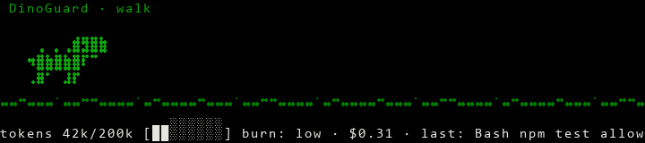

# DinoGuard 🦕

Local guardrails and observability for AI coding agents: Claude Code today, plus 13 more harnesses in beta (Cursor,
Codex, Copilot, Gemini CLI, Goose and others) and your own agents through the SDK. DinoGuard sits between the agent's harness and the real action. **Before** every tool call it answers
**allow / instruct / deny**. It records everything locally, shows a live dotted dino runner, and gives you a
dashboard, audits, evals, alerts and phone approvals.



Architecture inspired by FailproofAI. No code reused.

## Quick start

```bash
pipx install dinoguard          # or: pip install dinoguard
dinoguard install               # Claude Code hooks (user scope) + fail-closed daemon, started on login too
dinoguard notch                 # floating always-on-top dino pill beside your apps (--autostart: open on login)
dinoguard runner                # dotted dino strip for a split pane
dinoguard dashboard             # http://127.0.0.1:8030
dinoguard demo                  # 60 s scripted risky session that shows every runner state
```

`dinoguard install` works non-interactively (set `DG_NO_FIRST_RUN=1` to skip the first-run wizard). Other harnesses
(beta): `dinoguard install --harness cursor|codex|copilot|gemini|opencode|goose|devin|droid|deepagents|antigravity|pi|openclaw|hermes
[--scope user|project|local]`. Undo with
`dinoguard uninstall`, which restores your settings file byte-for-byte.

## How it works

```
harness hook JSON → adapter → canonical event → policy engine (daemon) → decision → adapter → native response
                                                     │
                       SQLite store · stream.jsonl · runner · dashboard · alerts · reviewer
```

- **Adapters** turn each harness's events and tool names into one canonical shape. Policies never see
  harness-specific formats. See `docs/adapters/`.
- **Fail-closed daemon:** once configured, if `dinoguardd` is down, times out or speaks another protocol version,
  every guarded action is denied with a hint to run `dinoguard doctor`. (Windows uses a localhost TCP socket with an
  auth token, because CPython has no `AF_UNIX` there.)
- **Engine:** built-ins run first, first deny wins, instructs are merged, each policy has a 10 s deadline,
  observe/enforce per policy, hard/reviewable authority. `guard-self-protect` is always on.

## Policies

50 built-ins across self-protection, secrets, environment, dangerous commands, infrastructure, git, database,
packages, AI failure modes (loops, hallucinated paths, goal drift, finished tasks, destructive shapes), turn-end
workflow gates, token coaching and phone approval.

```bash
dinoguard policies                       # list with enabled/mode/authority
dinoguard policies enforce no-git-add-all
dinoguard policies set token-budget budget_usd=5
```

Write your own in `.dinoguard/policies/*policies.py` (project) or `~/.dinoguard/policies/` (user):

```python
from dinoguard import policy, allow, deny

@policy(name="no-generated-edits", events=["PreToolUse"], params={"dirs": ["dist", "generated"]})
def no_generated_edits(ctx):
    if ctx.tool_name in ("Write", "Edit"):
        path = str(ctx.tool_input.get("file_path", ""))
        if any(f"/{d}/" in f"/{path}" for d in ctx.params["dirs"]):
            return deny("Edit the source and run the generator instead.")
    return allow()
```

New custom policies start in **observe** mode. Or let DinoGuard draft one (path / command / regex templates; with
an LLM configured, a full draft, **beta**):
`dinoguard policy new "never touch the payments folder"` → `test` → `backtest` → `publish` →
`deploy --mode observe` → `policies enforce`, and `rollback` if needed.

## Everything else

**Status.** The core guard (hooks, policies, fail-closed daemon, runner, dashboard, audit) runs live with Claude Code
on Windows, and the LLM reviewer has been run against Gemini. Rows marked **beta** are built and covered by tests
with stand-in services or recorded payloads, but haven't run against the real service or harness yet. Please
[open an issue](https://github.com/hanish-8880/Dino-guard/issues) if one misbehaves.

| Feature | Command / place |
|---|---|
| Dotted dino runner (terminal / web) | `dinoguard runner`, `dinoguard runner --web` |
| Dashboard: home, sessions, traces + sub-agent graph, live, policies, audit, insights, evals, alerts, metrics (p50/p95/p99), SQL queries + tiles, settings, Ctrl+J assistant | `dinoguard dashboard` |
| Local audit of past Claude Code sessions | `dinoguard audit [--goal "..."] [--project P] [--session ID] [--env E] [--context FILE] [--schedule 7] [--email you@x]` |
| Agent contract (`should` / `should_not` in `.dinoguard/contract.yaml`), checked by audits and the `contract-should-not` policy | `dinoguard audit`, `dinoguard policies enable contract-should-not` |
| Audit history + coverage, recurrence check (a fixed failure that comes back reopens its insight and alerts) | `dinoguard audit --history` |
| Finding → suggested policy, installed in observe mode | `dinoguard audit suggest <finding-id> --install` |
| Compare two sessions, or groups by model / harness / environment / outcome | `dinoguard compare A B`, `dinoguard compare --by model` |
| Error groups (fingerprinted), tool + policy analytics | `dinoguard errors`, dashboard Metrics page |
| Trace export (redacted JSON / JSONL) | `dinoguard export <session> --format jsonl` |
| Retention + configurable redaction (`retention_days`, `redaction.extra_patterns`, `redaction.store_outputs`) | `dinoguard prune [--days N] [--dry-run]` |
| Environment labels on sessions | `DG_ENV=staging` |
| Hook drift warnings + per-harness capability table | `dinoguard doctor`, `dinoguard status` |
| LLM reviewer for reviewable policies (any OpenAI-compatible endpoint; tested with Gemini 2.5 Flash) | `dinoguard reviewer setup --url ... --model ... --key-stdin --mode observe` |
| **beta:** Phone approval (Telegram / WhatsApp via Twilio or Meta) | `dinoguard approve setup --telegram`, `dinoguard policies enforce phone-approval` |
| Alerts ("tell me when denies > 5 in 10 minutes") → insights. **beta:** the Slack / email / webhook / Telegram / WhatsApp delivery | `dinoguard alerts new "..." --channel ops` |
| Evals: safe code expressions + built-in sentiment. **beta:** LLM judge, classifier, external worker | `dinoguard eval new|test|deploy|backfill|results|rollback` |
| Eval from plain words (template matcher; **beta:** LLM drafting); compare scores by group | `dinoguard eval new cheap --from "cost under $1"`, `dinoguard eval results cheap --by model` |
| Ask your data (read-only SQL) + MCP server | `dinoguard ask "..."`, `dinoguard mcp` |
| Policy packs from a folder, or (**beta**) from GitHub releases (SHA256SUMS-pinned; integrity, not a signature). `DG_NO_DOWNLOAD=1` = offline, `DG_PACK_BASE_URL` = mirror | `dinoguard policies add owner/repo@tag`, `github:o/r@tag`, a release URL, or `./folder`; `--only pack:policy` |
| SDK for custom agents + OpenTelemetry ingest | `from dinoguard import check`, `docs/adapters/sdk.md` |
| Lifecycle tracer (model calls, tools, humans, errors, pause/resume) + framework helpers (LangChain, LlamaIndex, CrewAI, Pydantic AI, Deep Agents) | `with dinoguard.trace_session(...) as t:`, `dinoguard.frameworks` |
| Any language over HTTP; JS/TS client with no dependencies | `POST /api/v1/events`, `sdk/ts/dinoguard.mjs` |
| **beta:** Other harnesses: Cursor, Codex, Copilot, Gemini CLI, OpenCode, Goose, Devin, Factory Droid, Deep Agents Code, Antigravity, Pi, OpenClaw, Hermes (each checked against its current hook docs; see the limits in `docs/adapters/`) | `dinoguard install --harness devin|droid|deepagents|antigravity|pi|openclaw|hermes`, `docs/adapters/` |
| MCP write tools that need your yes first; MCP over local HTTP | `dinoguard mcp --http`, approve with `dinoguard approve answer <code> yes` |
| Undo hint: git checkpoint before allowed risky actions | `dinoguard undo [<event-id>]` |

All data stays in `~/.dinoguard/` (SQLite in WAL mode plus `stream.jsonl`). Secrets are redacted before storage.
Stored data older than `retention_days` (default 90) is pruned once a day by the daemon; set it to `0` to keep
everything. There is no cap on runs, evals or audits: it is your laptop.
Network calls happen only for the optional reviewer/LLM features, alerts, approvals, and pack downloads.

## Development

```bash
pip install -e ".[dev]"
pytest -q
python demo/make_gif.py      # regenerate docs/runner.gif (needs Pillow)
```

See `PROGRESS.md` for build status and `CLAUDE.md` for the design.
